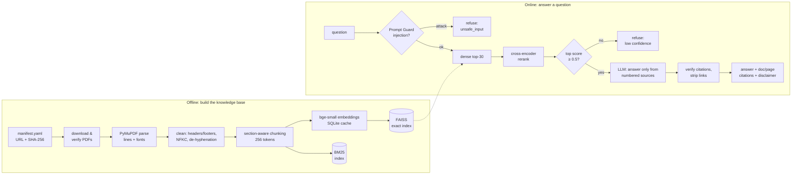

# MedDoc RAG

[](https://github.com/Yusuf-469/RAG/actions/workflows/ci.yml)

**Citation-grounded question answering over 8 public WHO, CDC and NIH clinical guidelines (1,077 pages).**
Every answer cites document and page, the system says "I don't know" when the guidelines don't
contain the answer, and every design choice is backed by a measured evaluation.

> ⚠️ **Educational project. Not medical advice.** Answers can be wrong; always consult the original
> guideline and a qualified healthcare professional.

| | Result | Source |
|---|---|---|
| Retrieval (best config) | **Hit@5 95.8%, MRR 0.741** on 48 hand-verified questions | [retrieval eval](eval/results/retrieval_20261015-202416.md) |
| Answer correctness | **44/48 correct (91.7%)**, 3 partial, 1 incorrect, manually audited | [judge audit](eval/results/judge_audit_20261015-203918.md) |
| Refusals | **11/11 out-of-scope questions refused**, 48/48 answerable answered | [generation eval](eval/results/generation_20261015-203918.md) |
| Citations | **0** citations to sources the model was not given | [generation eval](eval/results/generation_20261015-203918.md) |
| Prompt injection | **12/12** attack prompts blocked, **0/67** benign questions blocked; poisoned-document attacks **0/12** | [safety eval](eval/results/safety_20261019-130152.md) |
| Latency (CPU + Groq) | ~0.6 s retrieval, ~1–3 s generation | [generation eval](eval/results/generation_20261015-203918.md) |

---

## Contents
[Architecture](#architecture) · [Quickstart](#quickstart) · [Evaluation](#evaluation) ·
[Safety](#safety) · [Design decisions](#design-decisions) · [Corpus](#corpus) ·
[Limitations](#limitations) · [Future work](#future-work) · [Project structure](#project-structure)

## Architecture



- **Offline:** PDFs are parsed into one cleaned string per document with page and section offsets;
  chunks are character spans over it, so every chunk knows its physical page and section path.
- **Online:** the question is screened, retrieved (dense search → cross-encoder rerank), gated on
  relevance, answered by an LLM that may only use numbered sources, then checked in code.
- **Serving:** FastAPI (`/ask`, `/health`, `/metrics`) + a thin Streamlit client, packaged as one
  Docker image run as two compose services.

## Quickstart

Requires Python 3.11 and a free [Groq API key](https://console.groq.com) (no card needed).

```bash
python -m venv .venv && .venv\Scripts\activate         # Linux/macOS: source .venv/bin/activate
pip install -e ".[dev,ui]"
python scripts/download_docs.py                         # 3 CDC PDFs need a manual browser download (printed steps)
python scripts/build_chunks.py && python scripts/build_index.py
copy .env.example .env                                  # then set GROQ_API_KEY (Linux/macOS: cp)
```

Run it:

```bash
uvicorn app.api:app --port 8000      # API, interactive docs at http://127.0.0.1:8000/docs
streamlit run app/ui.py              # UI at http://127.0.0.1:8501
python scripts/ask.py "How much physical activity should older adults do?"   # CLI
docker compose up --build            # or both services in containers
pytest                               # 108 tests, no models or API key needed
```

Example API call:

```bash
curl -X POST http://127.0.0.1:8000/ask -H "Content-Type: application/json" \
     -d '{"question": "What is the daily sodium limit in the Dietary Guidelines for Americans?"}'
```

Returns the answer, refusal reason (if any), retrieval confidence, citations (`"Dietary Guidelines
for Americans, 2020-2025, pp.31-32"`), all source chunks with highlighted supporting sentences, and
a per-stage latency breakdown.

## Evaluation

All numbers come from the committed files in [`eval/results/`](eval/results/). Re-run with
`python eval/run_retrieval_eval.py`, `eval/run_generation_eval.py` and `eval/run_safety_eval.py`.

### Golden set

[`eval/golden_set.jsonl`](eval/golden_set.jsonl): **59 questions**: 48 answerable (18 fact,
12 number, 11 paraphrase, 4 confusable-document, 3 regression) and 11 out-of-scope, including
near-misses whose topic is in the corpus but whose answer is not (MRSA treatment, HbA1c targets).

Gold labels are **exact evidence quotes**, not chunk ids, so they are independent of the chunking
strategy. [`eval/verify_golden.py`](eval/verify_golden.py) locates every quote in the parsed text.
A retrieved chunk counts as relevant if it covers ≥50% of a gold quote's characters. Seven items
gained extra evidence after inspecting misses (TREC-style pooled judgments, marked `"pooled": true`);
the [pre-adjudication run](eval/results/retrieval_20261015-201859.md) is kept.

### Retrieval: 3 chunking strategies × 5 retrievers

| Chunking | Retriever | Hit@1 | Hit@5 | MRR@10 | p50 latency |
|---|---|---|---|---|---|
| fixed | dense | 45.8 | 77.1 | 0.571 | 18 ms |
| fixed | dense + rerank | 56.2 | 83.3 | 0.687 | 650 ms |
| recursive | dense | 52.1 | 85.4 | 0.646 | 19 ms |
| recursive | dense + rerank | 58.3 | 89.6 | 0.706 | 651 ms |
| section | dense | 50.0 | 89.6 | 0.653 | 21 ms |
| section | BM25 | 43.8 | 79.2 | 0.589 | 6 ms |
| section | hybrid (BM25 + dense, RRF) | 52.1 | 91.7 | 0.668 | 32 ms |
| **section** | **dense + rerank** (default) | **58.3** | **95.8** | **0.741** | 626 ms |
| section | hybrid + rerank | 58.3 | 93.8 | 0.735 | 659 ms |

[Full table](eval/results/retrieval_20261015-202416.md) (16 configurations, per-type breakdown).

**Statistical significance** (paired bootstrap, 10,000 resamples; with 48 questions one question = 2.1 points):

| Comparison | Δ Hit@5 | 95% CI | Verdict |
|---|---|---|---|
| Section-aware vs fixed-size chunking (dense + rerank) | **+12.5** | **[+4.2, +22.9]** | significant |
| Section-aware vs recursive | +6.2 | [0.0, +14.6] | directional only |
| Hybrid vs dense (with rerank) | −2.1 | [−6.2, 0.0] | no difference |
| bge query instruction vs none | −2.1 | [−6.2, 0.0] | no effect |

Reranking raised MRR in all three strategies (+0.088 for section-aware, CI [−0.006, +0.181]).
Hybrid search did **not** help on this corpus: dense retrieval already scored 100% on number
questions ("2,300 mg", "50 MME"), so the simpler dense + rerank pipeline is the default.

### Generation

Default pipeline, generator `openai/gpt-oss-120b`, judge `qwen/qwen3.8-27b` (a different model family,
to avoid self-preference), refusal threshold 0.5:

| Metric | Result |
|---|---|
| Answerable questions answered | 48/48 |
| Out-of-scope refused | 11/11: 7 by the relevance gate, **4 near-misses by the LLM's grounded refusal** |
| Correct, manually audited | **44/48 (91.7%)**: 3 partial, 1 incorrect |
| LLM-judge agreement with the audit | 46/48 correctness, 47/48 faithfulness verdicts |
| Mean claim-level faithfulness (judge) | 96.9% |
| Citations to non-provided sources | 0 |

A threshold of 0.95 chosen by sweeping on the same questions reached "100% refusal" by a 0.001
margin while refusing 3 real questions: overfitting. The [overfit run](eval/results/generation_20261015-203654.md)
is kept and marked; the loose gate + LLM refusal design is the robust alternative.

## Safety

| Layer | Defends against |
|---|---|
| Llama Prompt Guard 2 (86M) on every question | direct prompt injection / jailbreaks |
| Sources in `<source>` tags declared as data; fake closing tags escaped | indirect injection from documents |
| Numbered citations verified in code | fabricated citations |
| Output policy: sentences with URLs/domains removed | injected links and spam |
| Keyword-based emergency notice (chest pain, overdose, self-harm, stroke signs…) | users in crisis |
| Disclaimer added by code; question text never logged | misuse; privacy |

[Adversarial evaluation](eval/results/safety_20261019-130152.md): attack prompts blocked **12/12**;
benign questions blocked **0/67** (incl. "Should I ignore a missed dose?"). Poisoned documents
planted at rank 1 (hijack, 10× dose, spam link, misinformation): **3/12** attacks reached the
answer before the output link policy ([run](eval/results/safety_20261019-125739.md)), **0/12** after.

## Design decisions

| Decision | Why (measured where possible) |
|---|---|
| PyMuPDF over pypdf | 2.2 s vs 19.5 s on 1,077 pages, same text quality, exposes font size for heading detection |
| Clean text at line level before joining | keeps character offsets valid, so page citations stay exact |
| Statistical header/footer removal | lines repeating at page edges on ≥20% of pages; works for any publisher |
| Headings from PDF bookmarks, font fallback | 6/8 PDFs have bookmarks; font rules are relative to each document's body size (1.09×–1.6×) |
| Section-aware chunking, 256 tokens | significantly better Hit@5 than fixed-size; measured in model tokens because the model truncates on tokens |
| bge-small-en-v1.5 + exact FAISS | free, local, 384-d; at ~3.7k chunks brute force is sub-millisecond and exact, so eval measures the method |
| Cross-encoder rerank of top 30 | main lever for ranking quality; latency linear (~17 ms/candidate on CPU) |
| Cite numbered sources, map pages in code | an LLM can invent a page number, not a valid source number |
| Groq free tier, swappable with Ollama | ₹0 budget; one `LLMClient` interface; all responses cached so eval re-runs cost nothing |
| Manifest + SHA-256, PDFs not committed | reproducible corpus, licence-respecting, small repo |
| Quiz section excluded via manifest | a CE quiz distractor (">60 seconds") was once cited as guideline fact |

## Corpus

| Document | Publisher | Pages | Licence |
|---|---|---|---|
| Guideline for the pharmacological treatment of hypertension in adults (2021) | WHO | 61 | CC BY-NC-SA 3.0 IGO |
| Guidelines on physical activity and sedentary behaviour (2020) | WHO | 104 | CC BY-NC-SA 3.0 IGO |
| Guideline: Sugars intake for adults and children (2015) | WHO | 59 | CC BY-NC-SA 3.0 IGO |
| Dietary Guidelines for Americans 2020–2025 | USDA/HHS | 164 | Public domain |
| Clinical Practice Guideline for Prescribing Opioids for Pain (2022) | CDC | 100 | Public domain |
| 2020 Focused Updates to the Asthma Management Guidelines | NIH/NHLBI | 322 | Public domain |
| Guideline for Isolation Precautions (2007) | CDC | 211 | Public domain |
| Guideline for Hand Hygiene in Health-Care Settings (2002) | CDC | 56 | Public domain |

Two confusable pairs (WHO sugars vs US Dietary Guidelines; isolation vs hand hygiene) make
wrong-document retrieval possible, so retrieval improvements are measurable. PDFs are downloaded and
checksum-verified from [`data/manifest.yaml`](data/manifest.yaml), never redistributed.

## Limitations

- **Small evaluation set** (59 questions): only large differences are statistically detectable.
- **Hit@1 is ~58%**: the top chunk is often a rationale paragraph next to the recommendation. The one
  incorrect answer presented observational data (median 4–7 days of opioids) as a recommendation.
- **Citations prove provenance, not truth**: found failure modes include a quiz distractor and a
  contradicted antiseptic suggestion; corpus curation and human audit remain necessary.
- Tables and figures are flattened to text; infographic pages produce noisy chunks.
- The reranker is trained on web search (MS MARCO), not clinical text.
- Free-tier rate limits (8k tokens/min per model) cap throughput.
- Emergency detection is keyword-based and deliberately over-warns.
- English only; guidelines may be superseded by newer versions.

## Future work

- Multimodal indexing of figures and tables (vision-model descriptions), measured on a figure/table question subset
- Boost recommendation text in ranking; try a medical cross-encoder or a larger reranker
- Larger golden set with rare identifiers (where BM25 should matter) and more paraphrases
- Chunk-size sweep (128/256/512) and removal of front matter, each as a measured ablation
- Scan the corpus with the injection classifier at indexing time
- Separate slimmer API and UI images

## Project structure

```
src/meddoc_rag/
  ingestion/     loader (PyMuPDF), cleaner, document assembly + headings, 3 chunkers
  indexing/      embedder + SQLite cache, FAISS index, BM25 index
  retrieval/     dense, BM25, hybrid (RRF), cross-encoder reranker
  generation/    LLM clients (Groq, Ollama) + cache, grounded prompt, answerer, highlighting
  evaluation/    golden set, retrieval metrics, LLM judge
  safety.py      prompt guard, emergency notices
  monitoring.py  JSON logging, latency tracker
app/             FastAPI service (api.py), Streamlit UI (ui.py)
eval/            golden set, evaluation scripts, committed results
scripts/         download, build chunks/indexes, CLI
tests/           108 tests (fakes for models, LLMs and HTTP)
data/manifest.yaml  sources, licences, checksums
```
